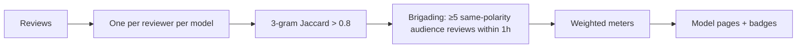

# Architecture — model-tomatoes

## 1. Scope
Practitioner reviews of AI models aggregated into trustworthy scores per use case.
**MVP:** reviews with use-case tags and verified hours, integrity filters (one per reviewer,
near-duplicate text, review bursts), credibility-weighted Tomatometer and Audience scores,
Certified Fresh, per-use-case scores.
**Product:** usage-verified reviewers (API-key attestations), consensus summaries, embeddable badges.

## 2. Pipeline

## 3. Scoring
- fresh = rating ≥ 3.5
- weight = `1 + ln(1 + verified_hours)`, so a 1,000-hour practitioner counts about 8× a drive-by,
  but no single reviewer dominates
- meter = weighted % fresh. Certified Fresh requires ≥ 75% and ≥ 20 critic reviews.
- the same meter is computed per use-case tag, which is the product's real value
  ("great at coding, rotten at writing")

## 4. Design decisions
- **Integrity filters run before scoring and are reported** (`rejected` count). Transparency is
  the moat against review gaming.
- **Log weighting, not linear.** It rewards expertise while resisting whales.
- **Critic vs. audience split** mirrors the Rotten Tomatoes mental model users already have.

## 5. Production architecture
Postgres (reviews, reviewers, attestations), a scoring job on write (incremental per model),
MinHash-LSH for near-duplicate detection at scale, and a CDN-cached read API for badges.

## 6. Limitations (sell-ready audit, 2026-10-28)
- No feature gating by plan: every API key unlocks the same software. Pro's
  embeddable meters and reviewer credibility tuning are not built (the web app
  sends `X-Frame-Options: DENY`; credibility weight is a fixed log-of-hours
  formula capped at 2,000 hours) and were removed from sales copy. Vendor
  Insights' alerts are not built and were removed.
- Usage hours are self-reported and only capped, not verified — the roadmap's
  API-key-signed attestations do not exist yet, so a reviewer can inflate
  credibility up to the cap. Review text is taken at face value apart from
  duplicate/burst filters.
- Docker build and a live Render/Fly deployment were not verified in the audit
  environment (no Docker binary there); Dockerfile, render.yaml, and fly.toml are
  the same template shape as vibe-lube, but a deployment claim remains
  "not verified" until one is made.
- Stripe prices were not verified against a live Stripe account in this run;
  checkout and revocation are covered in tests with mocked Stripe calls, and the
  README example now uses community/pro/vendor-insights plan keys to match the
  plan names.

## 7. Risks
Labs astroturfing (verification tied to real API usage, burst detection, reviewer reputation).
Model versioning: reviews attach to `model@version`, and pages show the version trend.
